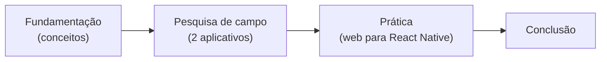
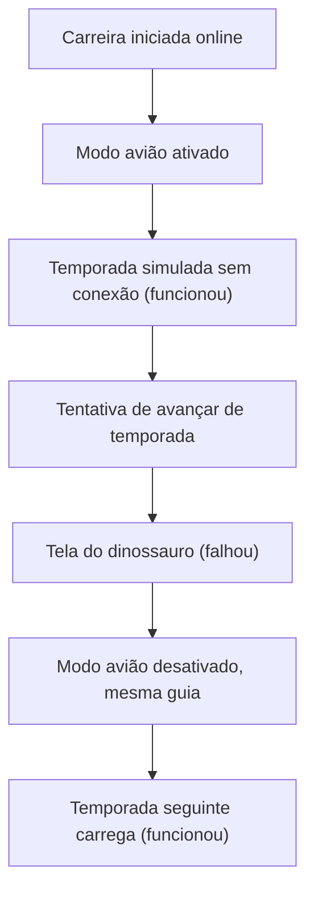

<!--
PRÉ-ENTREGA (estes comentários não aparecem no GitHub; apague-os no final)

1. Busque por "PREENCHER" (Cmd+F) e resolva TODAS as ocorrências.
2. Cada seção marcada como [PREENCHER] pede texto SEU, com as suas palavras (exigência do enunciado).
3. Prints em docs/apps/ e docs/comparacao/, com os nomes exatos usados nas tags .
4. Revise os parágrafos de "Análise": leia em voz alta e reescreva do seu jeito o que não soar como você.
5. Confira as datas e entradas da seção "Declaração de uso de IA". Uso não declarado = nota zero.
6. Abra o repositório em aba anônima: precisa estar público e o README renderizando sem imagens quebradas.
-->

<div align="center">

# Web × Mobile: diferenças de paradigma na prática

**Pesquisa de campo com dois aplicativos reais e reconstrução de uma seção web em React Native com Expo**


ADO 1 · Tecnologia em Sistemas para Internet · Centro Universitário Senac São Paulo

</div>

---

## Ficha do trabalho

| | |
| --- | --- |
| **Atividade** | ADO 1: Web x mobile, diferenças de paradigma na prática |
| **Aluno** | Tiago Antunes Paz de Oliveira |
| **Curso** | Tecnologia em Sistemas para Internet |
| **Instituição** | Centro Universitário Senac São Paulo |
| **Disciplina** | [PREENCHER] |
| **Modalidade** | Individual |
| **Data de entrega** | [PREENCHER] |
| **Aplicativos analisados** | TheFenomeno e Notion |
| **Seção reconstruída** | [PREENCHER] |

## Índice

1. [Visão geral](#1-visão-geral)
2. [Fundamentação](#2-fundamentação)
3. [Pesquisa de campo](#3-pesquisa-de-campo)
4. [Prática: da web para o React Native](#4-prática-da-web-para-o-react-native)
5. [Conclusão](#5-conclusão)
6. [Como executar o projeto](#6-como-executar-o-projeto)
7. [Estrutura do repositório](#7-estrutura-do-repositório)
8. [Convenções adotadas](#8-convenções-adotadas)
9. [Referências](#9-referências)
10. [Declaração de uso de IA](#10-declaração-de-uso-de-ia)

---

## 1. Visão geral

Desenvolver para web e desenvolver para mobile parecem tarefas parecidas, mas partem de premissas diferentes: quem controla a versão que o usuário usa, o que acontece quando o sistema suspende o app, o que a rede e a bateria permitem, como o usuário toca na tela. Este repositório investiga essas diferenças em três frentes:

1. **Fundamentação:** os conceitos que separam os dois paradigmas.
2. **Pesquisa de campo:** testes práticos com dois aplicativos que eu uso, comparando celular e laptop.
3. **Prática:** a reconstrução de uma seção de uma página web que desenvolvi, agora em React Native com Expo, registrando o que mudou no caminho.



### Como as evidências são classificadas

Para separar o que eu vi do que eu li, cada afirmação da pesquisa de campo carrega uma destas marcas:

| Marca | Significado |
| --- | --- |
| **Observado** | Resultado que eu presenciei durante o teste. |
| **Hipótese** | Explicação provável, mas que não consegui confirmar tecnicamente. |
| **Documentação** | Informação tirada de documentação oficial, não testada por mim. |

### Metodologia

Os testes foram exploratórios: usei cada aplicativo em dispositivos diferentes, repeti as mesmas situações (alternar de app, fechar e reabrir, ficar sem internet, editar e conferir em outro aparelho) e registrei o que aconteceu, com prints. Quando não foi possível determinar a causa técnica de um comportamento, ela aparece como hipótese, não como fato.

---

## 2. Fundamentação

> [!IMPORTANT]
> Esta seção precisa ser escrita com as minhas palavras, a partir das fontes listadas na seção 9. Cada subseção deve citar a fonte no texto.

### 2.1 Ciclo de build e distribuição

<!-- COBRIR: caminho "salvei o código até o usuário ter a nova versão" na web (build, deploy, cache) e no mobile (build, assinatura, envio, revisão Apple/Google, liberação gradual, usuários em versões antigas). Consequências para API, correções urgentes e compatibilidade. -->

[PREENCHER]

### 2.2 Ciclo de vida do aplicativo

<!-- COBRIR: estados ativo, segundo plano e encerrado pelo sistema; comparação com aba de navegador e programa de desktop; por que o estado precisa ser salvo. -->

[PREENCHER]

> Na pesquisa de campo, testei esse tema na prática: ver as seções [3.2](#32-thefenomeno) e [3.3](#33-notion) (testes de segundo plano e de persistência).

### 2.3 Restrições do dispositivo

<!-- COBRIR: bateria, memória, rede instável ou ausente, tamanho e densidade de tela, orientação, notch e safe area, permissões (câmera, localização, notificações). -->

[PREENCHER]

> Na pesquisa de campo, testei o comportamento sem rede nos dois aplicativos (testes offline das seções 3.2 e 3.3).

### 2.4 Entrada e interação

<!-- COBRIR: toque x mouse e teclado, tamanho mínimo da área de toque (com números e fonte: HIG e Material Design), gestos, teclado virtual cobrindo a tela. -->

[PREENCHER]

> Na pesquisa de campo, a criação do jogador no TheFenomeno mostrou o efeito do teclado virtual (teste de usabilidade da seção 3.2).

### 2.5 UX mobile

<!-- COBRIR: contexto de uso (em pé, uma mão, com pressa), zona do polegar, padrões de navegação mobile (tab bar, drawer, stack). -->

[PREENCHER]

---

## 3. Pesquisa de campo

### 3.1 Ambiente de teste

| Item | Celular | Laptop |
| --- | --- | --- |
| Aparelho e sistema | [PREENCHER] | [PREENCHER] |
| Navegador | Navegador do celular (Chrome) | Google Chrome |
| TheFenomeno | Acessado pelo navegador | Acessado pelo navegador |
| Notion | Aplicativo móvel | Versão web, acessada pelo Chrome |
| Conectividade | Modo avião ativado nos testes offline | Não aplicável |

> [!NOTE]
> No laptop, o Notion foi testado **pelo navegador**, e não pelo aplicativo desktop instalado. Os resultados abaixo valem para o que foi de fato testado e não devem ser atribuídos ao aplicativo desktop.

### 3.2 TheFenomeno

| | |
| --- | --- |
| **Site** | <https://www.thefenomeno.com/> |
| **O que é** | Simulador de carreira de futebol: o usuário cria um jogador, configura suas características e acompanha a trajetória ao longo das temporadas. |
| **Dispositivos testados** | Celular e laptop |

#### Resumo dos testes

| Teste | Resultado observado | Ponto da fundamentação |
| --- | --- | --- |
| Offline | Uma temporada inteira foi simulada em modo avião; avançar para a temporada seguinte falhou | Rede instável ou ausente |
| Segundo plano | A carreira continuou após alternar para o YouTube | Ciclo de vida |
| Fechar e reabrir a guia | A carreira foi recuperada | Ciclo de vida e persistência |
| Usabilidade no celular | Carreira confortável; criação do jogador difícil por causa do teclado virtual | Entrada e interação |
| Celular x laptop | A classificação aparece reduzida no celular e completa (20 times) no laptop | UX e telas |

<details>
<summary><strong>Teste 1: funcionamento offline</strong></summary>

<br>

**Procedimento.** Iniciei uma carreira com internet e, no começo da temporada, ativei o modo avião e continuei jogando.

**Observado.** Consegui simular uma temporada inteira sem conexão. Ao tentar avançar para a temporada seguinte, o navegador exibiu a tela do dinossauro e o carregamento não continuou. Desativei o modo avião **sem fechar a guia** e a temporada seguinte carregou normalmente.



**Análise.** **Hipótese:** parte da experiência continua funcionando sem rede, mas a transição entre temporadas depende de alguma operação que não se completou offline. Não consegui determinar se foi uma requisição ao servidor, o carregamento de algum recurso ou outro motivo. O teste mostra que uma aplicação web pode manter funções disponíveis sem conexão sem estar preparada para funcionar offline por inteiro.

<table>
  <tr>
    <td align="center"><br><sub>Temporada funcionando em modo avião</sub></td>
    <td align="center"><br><sub>Falha ao avançar para a temporada seguinte</sub></td>
  </tr>
</table>

</details>

<details>
<summary><strong>Teste 2: segundo plano</strong></summary>

<br>

**Procedimento.** Iniciei uma carreira no navegador do celular, saí para usar o YouTube por alguns minutos e voltei.

**Observado.** A carreira continuou de onde estava, sem recomeçar.

**Análise.** O contexto necessário foi mantido durante a alternância de aplicativos, o que favorece o uso no celular. **Limite do teste:** ele não prova que o jogo permanece ativo em qualquer situação, já que o sistema operacional pode suspender ou encerrar processos para liberar memória e bateria.

</details>

<details>
<summary><strong>Teste 3: persistência após fechar a guia</strong></summary>

<br>

**Procedimento.** Com uma carreira iniciada no Chrome do celular, fechei a guia e abri o site de novo.

**Observado.** A carreira foi recuperada sem recomeçar.

**Análise.** As informações necessárias ficaram disponíveis depois do fechamento da guia, o que é diferente de apenas manter a página viva em segundo plano. **Limite do teste:** não identifiquei onde os dados são guardados, nem se o progresso sobreviveria à limpeza dos dados do navegador.

</details>

<details>
<summary><strong>Teste 4: usabilidade no celular</strong></summary>

<br>

**Procedimento.** Usei o jogo no navegador do celular durante a criação do jogador e durante a carreira.

**Observado.** A carreira foi tranquila, principalmente na orientação vertical, porque há poucos elementos para interagir. A criação do jogador foi mais difícil: são vários campos (nome, nacionalidade, número da camisa, posição e modo de jogo), o teclado virtual atrapalha e é preciso rolar bastante a tela.

**Análise.** A usabilidade não depende só do tamanho da tela, mas do tipo de interação pedida em cada etapa. A rolagem longa não é um problema em si, pois há muitas opções a apresentar. **Melhoria possível:** dividir a criação do jogador em etapas ou reposicionar os campos para facilitar o uso com o teclado virtual.

<table>
  <tr>
    <td align="center"><br><sub>Criação do jogador no celular</sub></td>
    <td align="center"><br><sub>Carreira no celular</sub></td>
  </tr>
</table>

</details>

<details>
<summary><strong>Teste 5: celular x laptop (classificação dos times)</strong></summary>

<br>

**Observado.** No celular, a tabela mostra uma seleção reduzida de times, que varia conforme a posição do time do jogador: aparecem os primeiros colocados, os últimos e as posições relevantes para a situação atual. No laptop, a tabela mostra os 20 times de uma vez, mas ocupa só uma pequena parte da tela e deixa uma grande área vazia à esquerda, o que passa a impressão de conteúdo deslocado.

| | Celular | Laptop |
| --- | --- | --- |
| Quantidade de times | Seleção reduzida e contextual | Os 20 times |
| Ponto forte | Compacta e fácil de ler em tela pequena | Visão completa da competição |
| Ponto fraco | Não mostra a classificação completa de uma vez | Uso ruim do espaço horizontal |

**Melhorias possíveis.** Centralizar ou reposicionar a tabela no desktop, aproveitar melhor a largura disponível e manter a visão compacta no celular, com acesso fácil a todos os times.

<table>
  <tr>
    <td align="center"><br><sub>Classificação no celular</sub></td>
    <td align="center"><br><sub>Classificação no laptop</sub></td>
  </tr>
</table>

</details>

#### Conclusão parcial

A carreira é confortável no celular, mas a criação do jogador sofre com o teclado virtual e a quantidade de campos. A classificação mostra duas estratégias de apresentação: reduzida e contextual no celular, completa mas mal distribuída no laptop. Quanto à conectividade, parte do jogo funciona offline e o progresso é recuperado ao reabrir a guia, mas o avanço entre temporadas exige conexão. Adaptar uma interface a dispositivos diferentes envolve mais do que reduzir elementos: envolve contexto de uso, tipo de interação e organização da informação.

### 3.3 Notion

| | |
| --- | --- |
| **Site** | <https://www.notion.com/> |
| **O que é** | Ferramenta de produtividade para organizar páginas e conteúdos em um workspace. |
| **Dispositivos testados** | Aplicativo móvel e versão web no Chrome do laptop |

#### Resumo dos testes

| Teste | Resultado observado | Ponto da fundamentação |
| --- | --- | --- |
| Offline | Funcionou no aplicativo móvel; não consegui usar offline pelo Chrome | Rede instável ou ausente |
| Segundo plano | A página continuou no mesmo ponto após alternar para o YouTube (no laptop) | Ciclo de vida |
| Fechar e reabrir a guia | A página foi achada em *Recents* e a frase escrita estava salva | Ciclo de vida e persistência |
| Sincronização | A edição apareceu no outro dispositivo sem atualizar a página | Rede e continuidade entre dispositivos |
| Navegação e polegar | [PREENCHER com a observação feita no celular] | UX mobile |

<details>
<summary><strong>Teste 1: funcionamento offline</strong></summary>

<br>

**Procedimento.** Verifiquei o acesso às páginas sem internet no aplicativo móvel e tentei localizar a mesma função no laptop, onde usei o Notion pelo Google Chrome.

**Observado.** O acesso offline funcionou no aplicativo móvel. No laptop, pelo navegador, não consegui usar o Notion offline.

**Análise.** O aplicativo móvel oferece acesso offline a páginas preparadas antes, enquanto a versão acessada pelo Chrome não ofereceu esse modo. **Limite do teste:** como o laptop foi testado pelo navegador, o resultado não permite concluir que o aplicativo desktop instalado também não tenha o recurso.

<table>
  <tr>
    <td align="center"><br><sub>Página disponível offline no celular</sub></td>
    <td align="center"><br><sub>Notion no Chrome do laptop</sub></td>
  </tr>
</table>

</details>

<details>
<summary><strong>Teste 2: segundo plano</strong></summary>

<br>

**Procedimento.** Abri uma página do Notion no Chrome do laptop, troquei para o YouTube por alguns minutos e voltei.

**Observado.** A página estava exatamente onde eu tinha deixado.

**Análise.** A alternância de guias não interrompeu o contexto, o que ajuda quem consulta outras fontes durante o trabalho. **Limite do teste:** avaliei a troca de guias do navegador, e não a suspensão de um aplicativo móvel nem o encerramento completo do navegador.

</details>

<details>
<summary><strong>Teste 3: persistência após fechar a guia</strong></summary>

<br>

**Procedimento.** Escrevi uma frase em uma página, esperei alguns segundos para salvar e fechei a guia. Depois reabri o Notion e procurei a página em *Recents*.

**Observado.** A página apareceu em *Recents* e a frase continuava salva.

**Análise.** A alteração permaneceu disponível após fechar e reabrir a guia, e *Recents* reduziu a necessidade de procurar a página na estrutura do workspace. **Limite do teste:** usei uma página e uma alteração de texto, sem cobrir outros tipos de conteúdo.

<table>
  <tr>
    <td align="center"><br><sub>Seção Recents</sub></td>
    <td align="center"><br><sub>Página reaberta com a frase salva</sub></td>
  </tr>
</table>

</details>

<details>
<summary><strong>Teste 4: sincronização entre dispositivos</strong></summary>

<br>

**Procedimento.** Editei uma página em um dispositivo e conferi no outro, entre o aplicativo móvel e a versão web no Chrome do laptop.

**Observado.** A alteração apareceu no outro dispositivo sem que eu atualizasse a página manualmente.

**Análise.** A sincronização foi automática, o que facilita começar uma tarefa no celular e continuar no laptop. **Limite do teste:** não avaliei conexões instáveis nem edição simultânea do mesmo conteúdo.

<table>
  <tr>
    <td align="center"><br><sub>Edição no dispositivo de origem</sub></td>
    <td align="center"><br><sub>Alteração no outro dispositivo, sem atualizar</sub></td>
  </tr>
</table>

</details>

<details>
<summary><strong>Navegação, edição e zona do polegar</strong></summary>

<br>

**Documentação.** Segundo a documentação consultada, o celular é projetado para toque, com teclado virtual e ferramentas de formatação perto da área de escrita, o que favorece consultas rápidas e registros em movimento. O desktop oferece mais espaço, teclado físico e atalhos, o que ajuda em edição longa e na organização de blocos. Essas são características gerais descritas na documentação, não resultados de testes meus.

**Observado.** [PREENCHER: onde ficam os botões principais do Notion no celular em relação ao polegar, usando o aparelho com uma mão só.]

</details>

#### Conclusão parcial

O Notion mostrou continuidade de uso: a página manteve o contexto ao trocar de guia, o conteúdo foi recuperado por *Recents* depois de fechar a guia e a edição sincronizou entre celular e laptop sem atualização manual. O acesso offline funcionou no aplicativo móvel, mas não no Chrome, diferença que deve ser lida considerando que o aplicativo desktop não foi testado.

### 3.4 Comparação entre os aplicativos

| Critério | TheFenomeno | Notion |
| --- | --- | --- |
| Objetivo | Simular uma carreira de futebol | Organizar informações e conteúdos |
| Experiência no celular | Carreira confortável; criação do jogador menos confortável | Acesso e edição de páginas pelo aplicativo móvel |
| Organização da informação | Classificação muda conforme o dispositivo e a posição do time | Páginas organizadas em um workspace |
| Segundo plano | Carreira continuou após alternar para o YouTube | Página manteve o contexto após alternar para o YouTube |
| Persistência | Carreira recuperada ao reabrir a guia | Página e alteração recuperadas por *Recents* |
| Uso offline | Uma temporada funcionou; avançar para a seguinte falhou | Funcionou no aplicativo móvel; não no Chrome |
| Entre dispositivos | Sincronização não testada | Alteração apareceu no outro dispositivo sem atualizar |
| Oportunidade de melhoria | Etapas na criação do jogador e melhor uso do espaço no desktop | Manter navegação consistente e facilitar a edição em telas diferentes |

#### Cobertura dos pontos da fundamentação

| Ponto da fundamentação | TheFenomeno | Notion |
| --- | --- | --- |
| Ciclo de vida (segundo plano e persistência) | Testado | Testado |
| Rede instável ou ausente | Testado | Testado |
| Entrada e interação (teclado virtual) | Testado | [PREENCHER ou remover] |
| UX e adaptação de tela | Testado | [PREENCHER] |
| Sincronização entre dispositivos | Não testado | Testado |

#### Principais diferenças encontradas

1. **Apresentação dos dados.** O TheFenomeno muda a quantidade de times conforme o ambiente e a posição na tabela; o Notion usa páginas pensadas para organizar e recuperar conteúdo.
2. **Contexto de uso.** No TheFenomeno a experiência muda conforme a atividade (carreira x criação do jogador); no Notion os testes destacaram a continuidade ao alternar entre aplicações e dispositivos.
3. **Persistência.** Os dois preservaram informações após interrupções: a carreira no TheFenomeno, a página e a edição no Notion.
4. **Comportamento offline.** O TheFenomeno manteve parte da simulação sem rede, mas não avançou de temporada; o Notion permitiu acesso offline no aplicativo móvel, não no Chrome.
5. **Sincronização.** No Notion foi possível ver a propagação de uma edição entre dispositivos. No TheFenomeno isso não foi testado, então não há comparação direta.
6. **Aproveitamento da tela.** O TheFenomeno deixou uma grande área vazia no laptop e sofreu com o teclado virtual no celular.

---

## 4. Prática: da web para o React Native

### 4.1 Seção escolhida

| | |
| --- | --- |
| **Seção** | [PREENCHER: Navbar, Hero, Footer ou outra] |
| **Página original** | [PREENCHER: link do projeto ou da página web] |
| **Por que escolhi** | [PREENCHER] |
| **Interação com `useState`** | [PREENCHER: por exemplo, abrir e fechar o menu] |

### 4.2 Comparação visual

<table>
  <tr>
    <th align="center">Versão web</th>
    <th align="center">App em React Native (Expo)</th>
  </tr>
  <tr>
    <td align="center"></td>
    <td align="center"></td>
  </tr>
</table>

### 4.3 Componentes e props

| Componente | Arquivo | Props recebidas | Estado local |
| --- | --- | --- | --- |
| [PREENCHER] | `src/components/[PREENCHER].js` | [PREENCHER] | [PREENCHER] |

O conteúdo da seção chega ao componente por props, e a estilização usa `StyleSheet` com Flexbox.

### 4.4 Diferenças encontradas na reconstrução

> [!IMPORTANT]
> Mínimo de 5 diferenças, todas encontradas por mim durante a reconstrução. Para cada uma: o que era na web, o que é no React Native e por que muda.

| Nº | Na web | No React Native | Por que muda |
| --- | --- | --- | --- |
| 1 | [PREENCHER] | [PREENCHER] | [PREENCHER] |
| 2 | [PREENCHER] | [PREENCHER] | [PREENCHER] |
| 3 | [PREENCHER] | [PREENCHER] | [PREENCHER] |
| 4 | [PREENCHER] | [PREENCHER] | [PREENCHER] |
| 5 | [PREENCHER] | [PREENCHER] | [PREENCHER] |
| 6 | [PREENCHER] | [PREENCHER] | [PREENCHER] |

---

## 5. Conclusão

<!-- O enunciado pede UM parágrafo, em primeira pessoa, respondendo: depois da pesquisa e da prática, o que preciso mudar na minha forma de pensar quando vou desenvolver para mobile? Amarre com algo concreto que você viveu (um teste, um erro na reconstrução). -->

[PREENCHER]

---

## 6. Como executar o projeto

**Pré-requisitos:** Node.js (versão LTS), npm e o aplicativo **Expo Go** no celular.

```bash
git clone https://github.com/TiagoAntunes-Dev/paradigmas-mobile-tiago-antunes.git
cd paradigmas-mobile-tiago-antunes
npm install
npx expo start
```

Escaneie o QR code com o Expo Go (Android) ou com a câmera (iOS) para abrir o app no celular.

---

## 7. Estrutura do repositório

```text
paradigmas-mobile-tiago-antunes/
├── README.md
├── App.js
├── index.js
├── app.json
├── package.json
├── assets/
├── src/
│   └── components/        # componentes em PascalCase
└── docs/
    ├── apps/              # prints dos aplicativos analisados
    └── comparacao/        # print da versão web x app em React Native
```

---

## 8. Convenções adotadas

| Tema | Convenção |
| --- | --- |
| Repositório | Público, kebab-case e minúsculo: `paradigmas-mobile-seunome` |
| Componentes | PascalCase |
| Pastas e arquivos de configuração | kebab-case ou minúsculo |
| Variáveis, funções e estilos | camelCase |
| Commits | [Conventional Commits](https://www.conventionalcommits.org/pt-br/v1.0.0/) |

Tipos de commit usados neste projeto:

| Tipo | Uso |
| --- | --- |
| `chore` | Configuração e criação do projeto |
| `docs` | Fundamentação, análises, prints e README |
| `feat` | Componente reconstruído e interações |
| `fix` | Correções |

---

## 9. Referências

<!-- Liste SOMENTE o que foi citado no texto. Mínimo de 3, padrão ABNT, com pelo menos 1 da bibliografia da disciplina. Preencha as datas de acesso. -->

ESCUDELARIO, B.; PINHO, D. **React Native**: desenvolvimento de aplicativos mobile com React. São Paulo: Casa do Código, 2021.

APPLE. **Human Interface Guidelines**. Disponível em: https://developer.apple.com/design/human-interface-guidelines. Acesso em: [PREENCHER].

GOOGLE. **Material Design 3**. Disponível em: https://m3.material.io. Acesso em: [PREENCHER].

REACT NATIVE. **Documentação oficial**. Disponível em: https://reactnative.dev/docs/getting-started. Acesso em: [PREENCHER].

NOTION. **Notion Help Center**. Disponível em: https://www.notion.com/help. Acesso em: [PREENCHER].

THEFENOMENO. **TheFenomeno**. Disponível em: https://www.thefenomeno.com/. Acesso em: [PREENCHER].

---

## 10. Declaração de uso de IA

ANTHROPIC. Claude (Claude Sonnet 5.5). Ferramenta de inteligência artificial generativa.
Data de uso: 16 out. 2026.
Finalidade: organização visual e estrutura do README (formatação, tabelas, diagramas e roteiro das seções) a partir das minhas anotações dos testes.
Arquivos impactados: README.md

ANTHROPIC. ChatGPT. Ferramenta de inteligência artificial generativa.
Data de uso: [PREENCHER].
Finalidade: orientação sobre o planejamento do trabalho e sobre comandos de Git e Expo (criação do projeto, correção do template e do histórico de commits).
Arquivos impactados: estrutura do repositório e histórico de commits; nenhum texto de conteúdo.

---

<div align="center">

Feito por **Tiago Antunes Paz de Oliveira** · [GitHub](https://github.com/TiagoAntunes-Dev) · Senac São Paulo · 2026

</div>
