<!--
PRÉ-ENTREGA (estes comentários não aparecem no GitHub; apague-os no final)

1. Busque por "PREENCHER" (Cmd+F) e resolva TODAS as ocorrências.
2. Cada seção marcada como [PREENCHER] pede texto SEU, com as suas palavras (exigência do enunciado).
3. Prints em docs/apps/ e docs/comparacao/, com os nomes exatos usados nas tags .
4. Revise os parágrafos de "Análise": leia em voz alta e reescreva do seu jeito o que não soar como você.
5. Confira as datas e entradas da seção "Declaração de uso de IA". Uso não declarado = nota zero.
6. Abra o repositório em aba anônima: precisa estar público e o README renderizando sem imagens quebradas.
-->

<div align="center">

# Web × Mobile: diferenças de paradigma na prática

**Pesquisa de campo com dois aplicativos reais e reconstrução de uma seção web em React Native com Expo**


ADO 1 · Tecnologia em Sistemas para Internet · Centro Universitário Senac São Paulo

</div>

---

## Ficha do trabalho

| | |
| --- | --- |
| **Atividade** | ADO 1: Web x mobile, diferenças de paradigma na prática |
| **Aluno** | Tiago Antunes Paz de Oliveira |
| **Curso** | Tecnologia em Sistemas para Internet |
| **Instituição** | Centro Universitário Senac São Paulo |
| **Disciplina** | [PREENCHER] |
| **Modalidade** | Individual |
| **Data de entrega** | [PREENCHER] |
| **Aplicativos analisados** | TheFenomeno e Notion |
| **Seção reconstruída** | [PREENCHER] |

## Índice

1. [Visão geral](#1-visão-geral)
2. [Fundamentação](#2-fundamentação)
3. [Pesquisa de campo](#3-pesquisa-de-campo)
4. [Prática: da web para o React Native](#4-prática-da-web-para-o-react-native)
5. [Conclusão](#5-conclusão)
6. [Como executar o projeto](#6-como-executar-o-projeto)
7. [Estrutura do repositório](#7-estrutura-do-repositório)
8. [Convenções adotadas](#8-convenções-adotadas)
9. [Referências](#9-referências)
10. [Declaração de uso de IA](#10-declaração-de-uso-de-ia)

---

## 1. Visão geral

Desenvolver para web e desenvolver para mobile parecem tarefas parecidas, mas partem de premissas diferentes: quem controla a versão que o usuário usa, o que acontece quando o sistema suspende o app, o que a rede e a bateria permitem, como o usuário toca na tela. Este repositório investiga essas diferenças em três frentes:

1. **Fundamentação:** os conceitos que separam os dois paradigmas.
2. **Pesquisa de campo:** testes práticos com dois aplicativos que eu uso, comparando celular e laptop.
3. **Prática:** a reconstrução de uma seção de uma página web que desenvolvi, agora em React Native com Expo, registrando o que mudou no caminho.

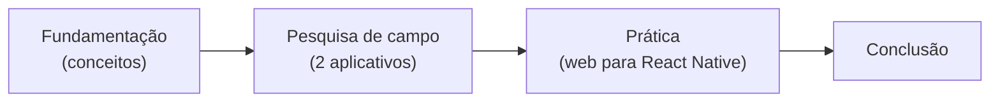

### Como as evidências são classificadas

Para separar o que eu vi do que eu li, cada afirmação da pesquisa de campo carrega uma destas marcas:

| Marca | Significado |
| --- | --- |
| **Observado** | Resultado que eu presenciei durante o teste. |
| **Hipótese** | Explicação provável, mas que não consegui confirmar tecnicamente. |
| **Documentação** | Informação tirada de documentação oficial, não testada por mim. |

### Metodologia

Os testes foram exploratórios e realizados em dispositivos diferentes, considerando as características e funcionalidades de cada aplicativo. Foram avaliados cenários como funcionamento sem conexão, alternância entre aplicativos, fechamento e reabertura de páginas, usabilidade e adaptação da interface. 

No Notion, também foi realizado um teste de sincronização entre dispositivos. Nem todos os cenários foram aplicados aos dois aplicativos, e os resultados foram registrados por meio de observações e capturas de tela. Quando não foi possível determinar a causa técnica de um comportamento, ela foi tratada como hipótese, e não como fato confirmado.

---

## 2. Fundamentação

> [!IMPORTANT]
> Completo com as cinco subseções, citações no corpo do texto e relações com os testes que realizados.

### 2.1 Ciclo de build e distribuição

No desenvolvimento web, as alterações costumam ser disponibilizadas por meio de uma nova publicação dos arquivos em um servidor ou serviço de hospedagem. Depois da publicação, o usuário acessa a versão atualizada pelo navegador, embora mecanismos de cache possam fazer com que alguns arquivos antigos continuem sendo utilizados temporariamente.

No desenvolvimento mobile nativo, o processo geralmente envolve gerar uma compilação instalável, assinar o pacote e distribuí-lo por uma loja de aplicativos ou por um canal de testes. No caso de Android e iOS, os pacotes e procedimentos de distribuição são diferentes, e a publicação pode envolver etapas de análise, testes e liberação controlada (EXPO, 2026).

Essa diferença afeta a manutenção do software. Uma aplicação web pode receber uma nova versão sem exigir que o usuário instale manualmente outro aplicativo, enquanto uma atualização mobile distribuída pela loja pode depender da publicação e da instalação de uma nova versão. Por isso, o desenvolvimento mobile precisa considerar que diferentes usuários podem continuar utilizando versões antigas, especialmente quando o aplicativo depende de uma API que também está sendo modificada.

Assim, a distribuição faz parte da arquitetura do projeto: além de implementar funcionalidades, é necessário planejar como elas serão disponibilizadas e como a compatibilidade será mantida durante as atualizações.

### 2.2 Ciclo de vida do aplicativo

O ciclo de vida descreve as mudanças pelas quais uma aplicação passa enquanto está sendo utilizada, fica em segundo plano ou deixa de estar ativa. Em aplicações mobile, o usuário pode alternar para outro aplicativo, bloquear o dispositivo ou voltar à tela inicial. O sistema operacional também pode encerrar um processo para liberar memória. No React Native, por exemplo, o módulo `AppState` permite identificar estados como `active` e `background` e acompanhar mudanças de estado (REACT NATIVE, 2026).

No navegador, alternar entre abas não é necessariamente a mesma situação que suspender um aplicativo nativo. A página pode continuar aberta, mas fechar a aba encerra aquela instância da página. Por isso, informações importantes não devem depender somente do estado mantido temporariamente na memória.

É necessário distinguir o estado visual de uma tela da persistência dos dados. O primeiro diz respeito a elementos como a página atual, os campos preenchidos e a posição de rolagem; a segunda garante que informações importantes continuem disponíveis após uma interrupção ou reabertura.

Essa diferença se relaciona aos testes realizados: no TheFenomeno, a carreira continuou disponível após alternar de aplicativo e fechar a aba; no Notion, a página permaneceu acessível e a frase escrita foi recuperada depois que a aba foi reaberta. Esses resultados mostram a importância da continuidade da experiência, embora não revelem, por si só, os mecanismos internos de armazenamento utilizados por cada serviço.

> Na pesquisa de campo, testei esse tema na prática: ver as seções [3.2](#32-thefenomeno) e [3.3](#33-notion) (testes de segundo plano e de persistência).

### 2.3 Restrições do dispositivo

O desenvolvimento mobile precisa considerar as limitações e características do dispositivo em que a aplicação será executada. Entre elas estão a memória disponível, o consumo de bateria, a qualidade da conexão, o tamanho da tela, a densidade de pixels, a orientação do aparelho e o espaço ocupado por elementos do próprio sistema, como áreas reservadas ao recorte da câmera e à navegação.

Essas condições afetam tanto o funcionamento quanto a apresentação da interface. Uma conexão instável pode impedir operações que dependem de um servidor; uma tela menor pode exigir a reorganização de listas e formulários; e o teclado virtual pode reduzir o espaço disponível durante o preenchimento de campos. Também é necessário considerar as permissões para recursos como câmera, localização e notificações, solicitando acesso quando ele for necessário à funcionalidade.

Os testes realizados ilustram algumas dessas situações. No TheFenomeno, foi possível continuar simulando a temporada atual sem conexão, mas não avançar para a seguinte até restabelecer a internet. Na criação de jogador, o teclado virtual e a quantidade de campos dificultaram o preenchimento. Já a tabela de classificação apresenta menos equipes simultaneamente no celular do que no laptop.

Esses exemplos demonstram que o projeto mobile deve considerar o contexto real de uso, em vez de apenas reproduzir o layout de uma tela maior em um espaço menor.

> Na pesquisa de campo, testei o comportamento sem rede nos dois aplicativos (testes offline das seções 3.2 e 3.3).

### 2.4 Entrada e interação

A interação na web tradicional pode utilizar mouse e teclado físico, enquanto em dispositivos móveis a principal forma de entrada costuma ser o toque, acompanhado de gestos e do teclado virtual. Essa diferença afeta o tamanho dos controles, a distância entre elementos interativos, o posicionamento dos formulários e a forma como o usuário recebe retorno de suas ações.

Os controles precisam ter áreas de toque adequadas para que sejam acionados com facilidade. As diretrizes da Apple recomendam, como regra geral, uma área de interação de pelo menos 44 × 44 pontos para botões; as orientações de acessibilidade do Android recomendam alvos de toque de pelo menos 48 × 48 dp (APPLE, 2026; ANDROID DEVELOPERS, 2026).

Os formulários merecem atenção especial. Quando o teclado virtual aparece, ele ocupa parte da tela e pode esconder campos ou botões. No React Native, componentes como `KeyboardAvoidingView` ajudam a ajustar a posição ou o espaçamento do conteúdo conforme a presença do teclado (REACT NATIVE, 2026).

Essa questão apareceu no teste do TheFenomeno: a criação de jogador exige diversas informações e rolagem, enquanto o teclado dificulta a visualização dos campos. A observação mostra que a usabilidade mobile não depende apenas de deixar os elementos menores; ela também exige adaptar a interação à forma como o usuário toca e digita no dispositivo.

> Na pesquisa de campo, a criação do jogador no TheFenomeno mostrou o efeito do teclado virtual (teste de usabilidade da seção 3.2).

### 2.5 UX mobile

A experiência do usuário em dispositivos móveis deve considerar o contexto em que o aparelho é utilizado. A tela costuma oferecer menos espaço do que um monitor, os controles são acionados por toque e o usuário pode estar em movimento, utilizando apenas uma das mãos ou alternando rapidamente entre aplicativos. Por isso, é importante priorizar as informações principais, evitar controles difíceis de alcançar e organizar a navegação de forma clara.

Adaptar a experiência não significa apenas reduzir o tamanho dos elementos da versão web. Dependendo da tarefa, pode ser necessário reorganizar o conteúdo, oferecer menus apropriados a telas menores e mostrar primeiro as informações mais relevantes. Em telas maiores, é possível aproveitar melhor o espaço e apresentar mais informações simultaneamente.

O teste do TheFenomeno demonstrou essa diferença na tabela de classificação: no laptop, as 20 equipes são exibidas de uma vez, mas sobra uma grande área vazia à esquerda. No celular, a lista mostra aproximadamente oito equipes e considera a posição do time controlado. A versão móvel facilita a leitura de uma quantidade menor de informações, embora não apresente a classificação completa ao mesmo tempo.

Assim, uma boa experiência mobile depende de entender a tarefa e o contexto de uso para escolher como organizar os elementos. A solução adequada não precisa ser idêntica à versão web, desde que preserve as funcionalidades importantes e facilite a realização das ações do usuário.

---

## 3. Pesquisa de campo

### 3.1 Ambiente de teste

| Item | Celular | Laptop |
| --- | --- | --- |
| Aparelho e sistema | Samsung Galaxy Note10+ | Dell Latitude 5480 — Windows 10 |
| Navegador | Navegador do celular (Chrome) | Google Chrome |
| TheFenomeno | Acessado pelo navegador | Acessado pelo navegador |
| Notion | Aplicativo móvel | Versão web, acessada pelo Chrome |
| Conectividade | Modo avião ativado nos testes offline | Conexão foi interrompida, por exemplo, Wi-Fi desativado |

> [!NOTE]
> No laptop, o Notion foi testado **pelo navegador**, e não pelo aplicativo desktop instalado. Os resultados abaixo valem para o que foi de fato testado e não devem ser atribuídos ao aplicativo desktop.

### 3.2 TheFenomeno

| | |
| --- | --- |
| **Site** | <https://www.thefenomeno.com/> |
| **O que é** | Simulador de carreira de futebol: o usuário cria um jogador, configura suas características e acompanha a trajetória ao longo das temporadas. |
| **Dispositivos testados** | Celular e laptop |

#### Resumo dos testes

| Teste | Resultado observado | Ponto da fundamentação |
| --- | --- | --- |
| Offline | A temporada em andamento continuou sem conexão; avançar para a seguinte falhou | Rede instável ou ausente |
| Segundo plano | A carreira continuou após alternar para o YouTube | Ciclo de vida |
| Fechar e reabrir a aba | A carreira foi recuperada | Ciclo de vida e persistência |
| Usabilidade no celular | Carreira confortável; criação do jogador prejudicada por rolagem e teclado virtual | Entrada e interação |
| Orientação da tela | A orientação vertical foi mais confortável para acompanhar a carreira; a horizontal foi registrada para comparação visual, sem avaliação sistemática completa. | Restrições do dispositivo |
| Celular x laptop | A classificação aparece reduzida no celular e completa (20 times) no laptop | UX e adaptação de tela |

<details open>
<summary><strong>Teste 1: funcionamento sem conexão</strong></summary>

<br>

**Procedimento.** Iniciei uma carreira com o site conectado, ativei o modo avião do celular e continuei usando o jogo.

**Observado.** Na temporada em andamento, consegui continuar simulando as partidas normalmente, mesmo sem conexão. Ao tentar avançar para a temporada seguinte, o navegador exibiu a página de erro conhecida como "dinossauro do Chrome". Para saber se seria preciso reiniciar o jogo, desativei o modo avião **sem fechar a aba**. Com a conexão restabelecida, consegui avançar para a próxima temporada.

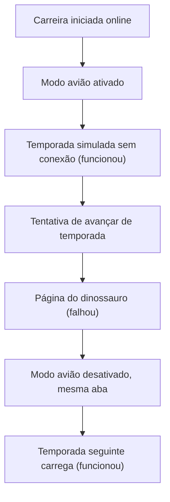

**Análise.** O teste indica que algumas funções da temporada em andamento continuam disponíveis sem conexão, mas a transição para a temporada seguinte parece depender de uma operação que exige internet (**hipótese**: não foi possível determinar qual processo causou o erro). A experiência offline é, portanto, parcial: algumas ações funcionam e outras não. Para o usuário, seria melhor que o jogo informasse o que está disponível offline e mostrasse uma mensagem específica quando uma ação exigir conexão, em vez da página de erro do navegador.

<table>
  <tr>
    <td align="center">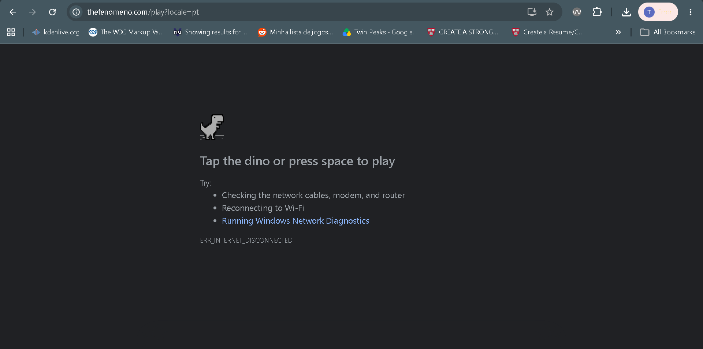<br><sub>Temporada funcionando sem conexão</sub></td>
  </tr>
</table>

</details>

<details open>
<summary><strong>Teste 2: segundo plano</strong></summary>

<br>

**Procedimento.** Iniciei uma carreira pelo navegador do celular, alternei para o aplicativo do YouTube por alguns minutos e voltei à aba do jogo.

**Observado.** A carreira continuava no estado esperado, sem que eu precisasse começar de novo.

**Análise.** Nesse teste, a troca temporária de aplicativos não interrompeu a experiência. Isso é importante no celular, onde o usuário costuma alternar entre vários aplicativos. **Limite do teste:** ele não permite afirmar que o jogo sempre manterá o estado. O comportamento pode variar conforme o navegador, a memória disponível e o gerenciamento de processos do sistema operacional.

</details>

<details open>
<summary><strong>Teste 3: persistência após fechar a aba</strong></summary>

<br>

**Procedimento.** Depois de iniciar uma carreira, fechei a aba do jogo no Chrome e abri o site novamente mais tarde.

**Observado.** A carreira estava disponível e continuei de onde havia parado.

**Análise.** O progresso foi preservado mesmo com o fechamento da aba, o que reduz o risco de o usuário perder o que fez ao encerrar a página. **Limite do teste:** não consigo dizer como os dados são armazenados, nem se a sessão é recuperada em qualquer situação. Para confirmar, seriam necessários testes adicionais, como limpar os dados do navegador ou acessar o jogo em outro dispositivo.

</details>

<details open>
<summary><strong>Teste 4: usabilidade e orientação no celular</strong></summary>

<br>

**Observado.** No celular, a tela da carreira ofereceu uma experiência relativamente confortável na orientação vertical: as ações para acompanhar a carreira são acessíveis e a navegação é adequada ao uso móvel. A criação do jogador foi menos confortável. O formulário pede várias informações (nome, nacionalidade, número, posição e opções do modo de jogo), e por isso é preciso percorrer boa parte da tela. O teclado virtual também atrapalha, porque ocupa parte do espaço e pode dificultar a visualização dos campos durante o preenchimento.

**Orientação da tela.** A orientação vertical foi a mais confortável durante o uso da carreira. Ao utilizar o celular na horizontal, a área disponível ficou mais larga e menos alta. A captura da tela horizontal complementa a comparação visual entre as orientações, mas não realizei uma avaliação sistemática de todos os componentes para determinar qual organização oferece melhor usabilidade em cada situação.

**Análise.** A quantidade de configurações se justifica pela complexidade de criar um jogador, mas a experiência poderia melhorar com um melhor gerenciamento do teclado, campos organizados em etapas e o campo selecionado aparecendo automaticamente na área visível. Isso reduziria a rolagem e deixaria o preenchimento mais confortável sem eliminar nenhuma opção.

<table>
  <tr>
    <td align="center">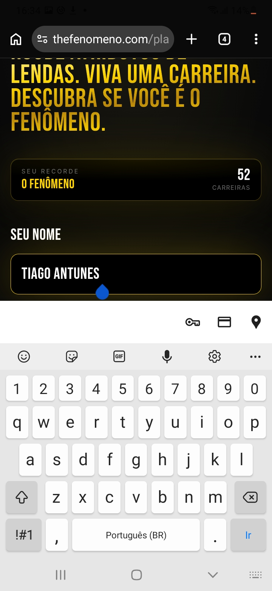<br><sub>Criação do jogador no celular</sub></td>
    <td align="center"><br><sub>Celular na horizontal</sub></td>
    <td align="center">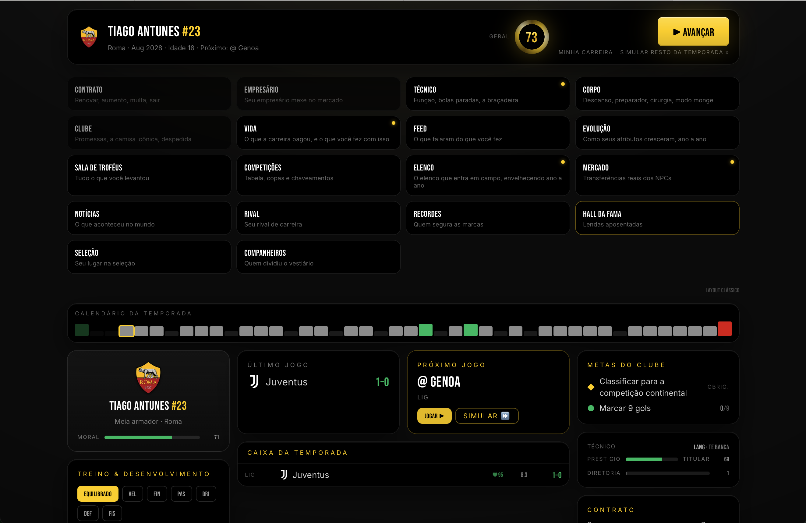<br><sub>Carreira no laptop (referência)</sub></td>
  </tr>
</table>

</details>

<details open>
<summary><strong>Teste 5: celular x laptop (tabela de classificação)</strong></summary>

<br>

**Observado.** No laptop, a tabela mostra as 20 equipes ao mesmo tempo, o que permite ver a classificação completa sem navegar pela lista. Porém, ela ocupa só uma parte da área disponível e deixa uma grande região vazia à esquerda, o que dá ao conteúdo um aspecto pouco equilibrado. No celular, a exibição é mais compacta: em vez de todas as equipes, a interface mostra cerca de oito, conforme a posição do time controlado. Quando o time está entre os primeiros, a lista prioriza equipes dessa região e também pode mostrar equipes da parte inferior; quando está perto da zona de rebaixamento, a exibição se adapta a essa posição.

| | Celular | Laptop |
| --- | --- | --- |
| Quantidade de times | Cerca de 8, conforme a posição do time | Os 20 times |
| Ponto forte | Compacta e fácil de ler em tela pequena | Visão completa para comparar todos os times |
| Ponto fraco | Não mostra a classificação completa de imediato | Tabela pouco centralizada e grande espaço vazio |

**Análise.** A interface mobile parece priorizar as informações mais relevantes para a situação atual do jogador, reduzindo o conteúdo exibido ao mesmo tempo, o que facilita a leitura em telas pequenas, embora impeça a visão imediata da classificação completa. No computador, mostrar todas as equipes facilita a comparação geral, mas o espaço poderia ser melhor aproveitado com uma tabela mais centralizada, uma área de conteúdo mais ampla ou uma distribuição visual mais equilibrada. A comparação mostra que adaptar uma interface ao celular não é só diminuir elementos: envolve selecionar e reorganizar as informações conforme o espaço e a tarefa do usuário.

<table>
  <tr>
    <td align="center">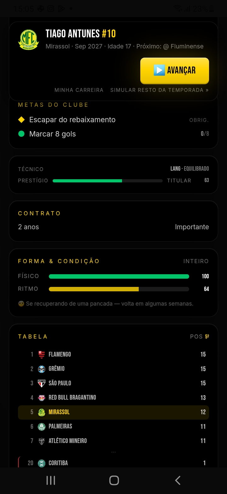<br><sub>Classificação no celular</sub></td>
    <td align="center"><br><sub>Classificação no laptop</sub></td>
  </tr>
</table>

</details>

### 3.3 Notion

| | |
| --- | --- |
| **Site** | <https://www.notion.com/> |
| **O que é** | Ferramenta de produtividade para organizar páginas e conteúdos em um workspace. |
| **Dispositivos testados** | Aplicativo móvel e versão web no Chrome do laptop |

#### Resumo dos testes

| Teste | Resultado observado | Ponto da fundamentação |
| --- | --- | --- |
| Offline | Funcionou no aplicativo móvel; não funcionou da mesma forma no Chrome | Rede instável ou ausente |
| Segundo plano | A página continuou no mesmo ponto após alternar para o YouTube (no laptop) | Ciclo de vida |
| Fechar e reabrir a aba | A frase escrita foi recuperada pelo *Recents* | Ciclo de vida e persistência |
| Sincronização | A edição apareceu no outro dispositivo sem atualizar a página | Continuidade entre dispositivos |
| Navegação e organização | *Recents* facilitou achar a página; o mesmo conteúdo abriu no app e no Chrome | UX |
| Permissões | Não fiz um teste específico de permissões | Restrições do dispositivo |

<details open>
<summary><strong>Teste 1: funcionamento offline</strong></summary>

<br>

**Procedimento.** No aplicativo móvel, testei o acesso sem conexão. No laptop, usei o Notion pelo Google Chrome e tentei o mesmo.

**Observado.** No celular, consegui acessar conteúdos que já estavam disponíveis no aplicativo, mesmo sem estar conectado. No Chrome do laptop, não consegui usar a página offline da mesma forma.

**Análise.** O aplicativo móvel permitiu acessar conteúdo sem conexão, e a versão do Chrome não apresentou o mesmo comportamento durante o teste. **Limite do teste:** no laptop usei a versão web, e não o aplicativo desktop instalado. Por isso, não é correto concluir que o Notion não oferece uso offline no computador. Esse recurso depende da versão utilizada e de como o conteúdo foi preparado. Para uma comparação completa, seria preciso testar também o aplicativo desktop e conferir as configurações de acesso offline.

<table>
  <tr>
    <td align="center">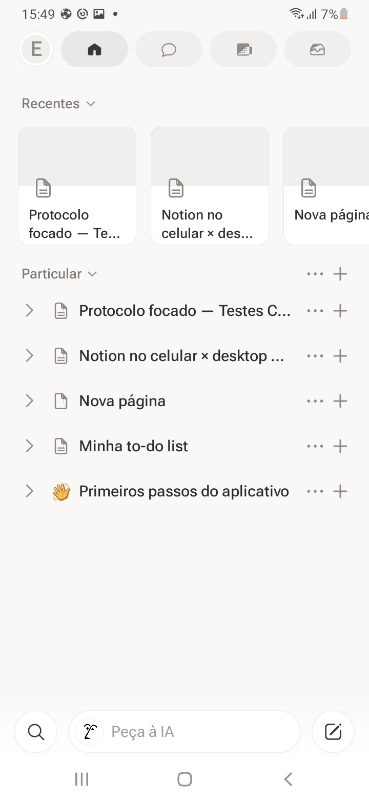<br><sub>Notion offline no celular</sub></td>
    <td align="center">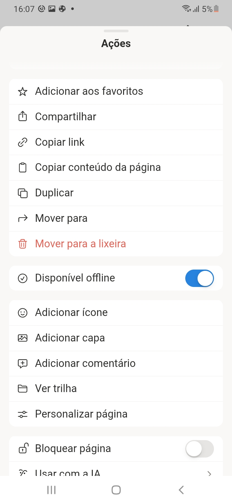<br><sub>Leitura de conteúdo offline no celular</sub></td>
  </tr>
  <tr>
    <td align="center">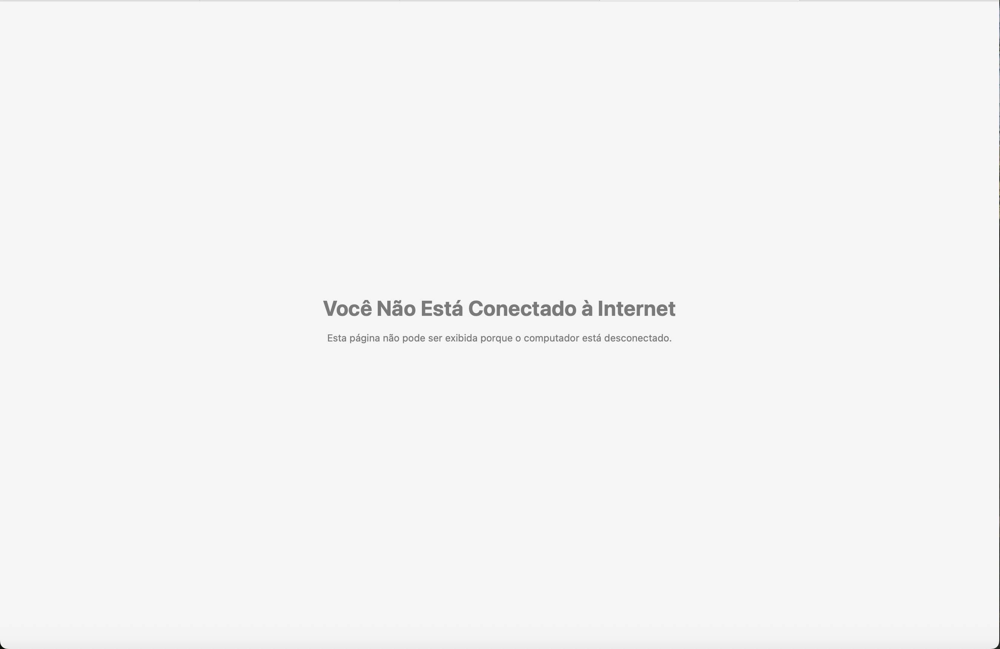<br><sub>Notion sem conexão no Chrome</sub></td>
    <td align="center">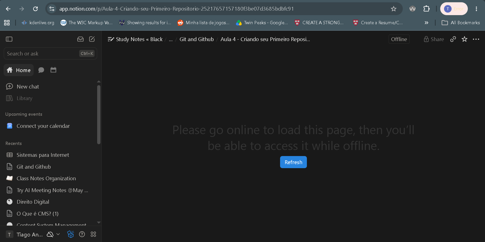<br><sub>Página sem conexão no Chrome</sub></td>
  </tr>
</table>

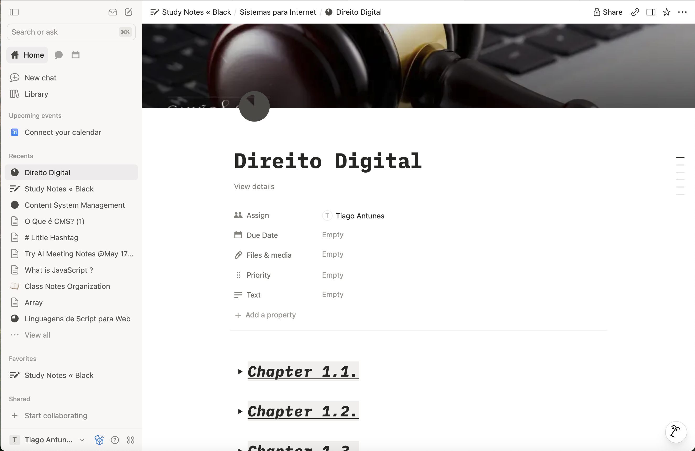

<sub>Notion aberto no Chrome do laptop</sub>

</details>

<details open>
<summary><strong>Teste 2: segundo plano</strong></summary>

<br>

**Procedimento.** No laptop, abri uma página do Notion no Chrome, alternei para o YouTube por alguns minutos e voltei à aba do Notion.

**Observado.** A página continuava no mesmo ponto em que eu a tinha deixado.

**Análise.** A alternância entre sites não fez a página perder o estado visível, o que dá continuidade à experiência: o usuário interrompe uma atividade e a retoma sem procurar o conteúdo de novo. **Limite do teste:** o resultado vale para o Chrome nessa situação. O navegador e o sistema operacional podem gerenciar abas e recursos de outro modo, conforme a memória disponível e o tempo de inatividade.

</details>

<details open>
<summary><strong>Teste 3: persistência após fechar a aba</strong></summary>

<br>

**Procedimento.** Escrevi uma frase em uma página do Notion, esperei alguns segundos para a alteração ser salva, fechei a aba e abri o Notion de novo. Para achar a página, usei a seção de itens recentes (*Recents*).

**Observado.** A frase que eu tinha escrito estava lá.

**Análise.** O conteúdo continuou disponível depois de fechar e reabrir a aba, e o *Recents* facilitou voltar à página usada. Isso importa em ferramentas de produtividade, onde o usuário precisa confiar que suas anotações continuarão ali depois de uma interrupção. **Limite do teste:** ele não revela o mecanismo interno de salvamento, apenas confirma que o conteúdo foi recuperado na situação observada.

<table>
  <tr>
    <td align="center">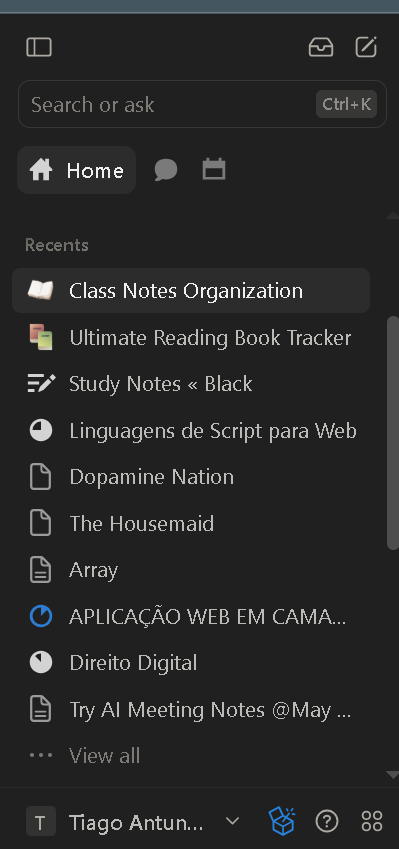<br><sub>Seção Recents</sub></td>
  </tr>
</table>

</details>

<details open>
<summary><strong>Teste 4: sincronização entre dispositivos</strong></summary>

<br>

**Procedimento.** Alterei uma página em um dispositivo e consultei a mesma página no outro, usando o aplicativo móvel e a versão web no Chrome do laptop.

**Observado.** A alteração apareceu no outro dispositivo sem que eu atualizasse a página manualmente.

**Análise.** As alterações foram sincronizadas entre as duas versões, o que permite alternar entre celular e laptop sem transferir conteúdo nem repetir modificações. É útil em ferramentas de organização, porque dá para começar uma atividade em um aparelho e continuar em outro. **Limite do teste:** o resultado vale para a alteração testada. Ele não garante sincronização instantânea em qualquer condição, principalmente com problemas de conexão ou edições simultâneas.

<table>
  <tr>
    <td align="center">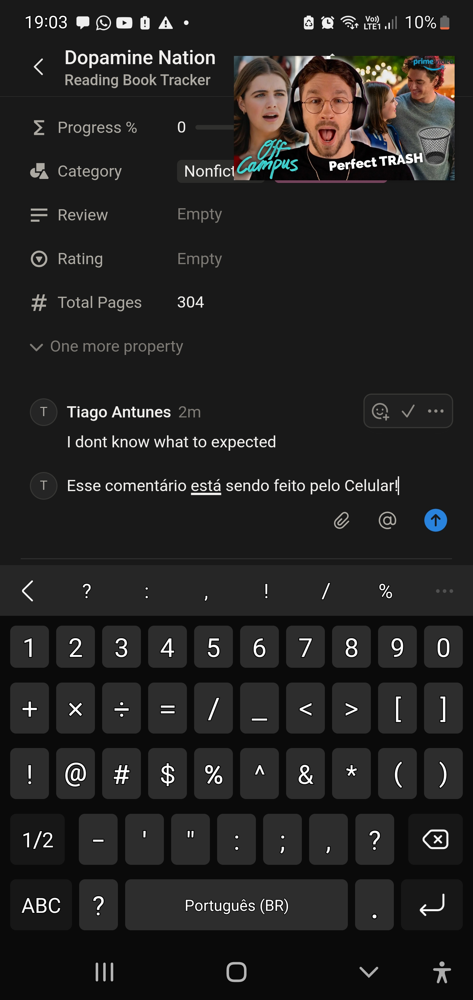<br><sub>Edição feita no celular</sub></td>
    <td align="center">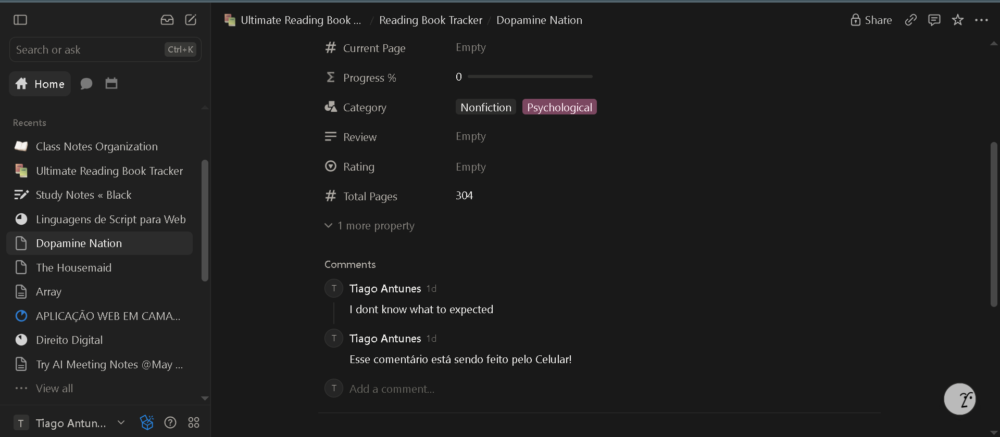<br><sub>Alteração no laptop, sem atualizar</sub></td>
  </tr>
</table>

</details>

<details open>
<summary><strong>Navegação e organização da interface</strong></summary>

<br>

**Observado.** A seção *Recents* facilita encontrar páginas acessadas antes, e foi especialmente útil no teste de recuperação depois de fechar a aba. Também foi possível alternar entre o aplicativo móvel e a versão web para abrir a mesma página e conferir as alterações.

**Documentação.** A documentação do Notion descreve diferenças de interface entre dispositivos: no celular, a organização privilegia controles adequados ao toque e ao espaço reduzido; no computador, a interface pode usar uma área maior para mostrar a navegação lateral e mais conteúdo ao mesmo tempo. Essas informações vêm da documentação, e não de testes meus.

**Análise.** Recuperar páginas recentes e acessar o mesmo conteúdo em dispositivos diferentes contribui para a continuidade do trabalho. Numa ferramenta de organização, a navegação precisa permitir que o usuário ache rápido o que procura e retome o que estava fazendo. As diferenças entre celular e computador são adaptações ao contexto de uso, não necessariamente limitações de uma das versões: a avaliação depende da atividade, do dispositivo e do que o usuário precisa.

</details>

<details open>
<summary><strong>Permissões no celular</strong></summary>

<br>

**Observado.** [PREENCHER: qual permissão o app pediu, em que momento pediu e se explicou o motivo.]

<table>
  <tr>
    <td align="center">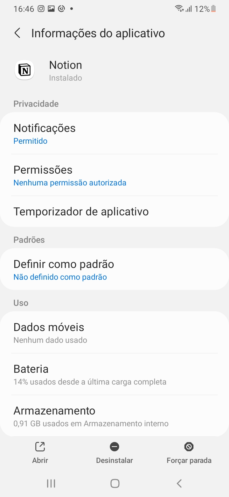<br><sub>Pedido de permissão no celular</sub></td>
  </tr>
</table>

</details>

### 3.4 Comparação entre os aplicativos

O TheFenomeno e o Notion têm finalidades diferentes, mas os dois mostram a importância de adaptar a experiência a cada plataforma. O TheFenomeno simula uma carreira esportiva, e a análise dele destacou o comportamento sem conexão, a recuperação do progresso, a interação com formulários e a adaptação da tabela de classificação a telas diferentes. O Notion é uma ferramenta de organização e produtividade, e os testes se concentraram em acesso offline, persistência das alterações, recuperação de páginas e sincronização entre o aplicativo móvel e a versão web.

No uso offline, o TheFenomeno deixou continuar a temporada em andamento, mas deu erro ao avançar para a seguinte sem conexão; no Notion, o aplicativo móvel permitiu acessar conteúdo offline, enquanto o Chrome no laptop não repetiu o resultado. Na continuidade de uso, os dois foram bem: no TheFenomeno foi possível trocar de aplicativo e reabrir o jogo sem perder a carreira, e no Notion a página permaneceu no mesmo ponto ao voltar à aba e o conteúdo escrito continuou lá depois de fechar e reabrir.

Na interface, o TheFenomeno reduz a quantidade de equipes na classificação do celular e mostra a tabela completa no computador. No Notion, as interfaces mobile e web oferecem formas de navegação adequadas aos respectivos dispositivos.

| Aspecto analisado | TheFenomeno | Notion |
| --- | --- | --- |
| Funcionamento offline | A temporada atual continuou, mas avançar para a seguinte exigiu restabelecer a conexão | O app móvel permitiu consultar conteúdo offline; no Chrome não consegui reproduzir |
| Segundo plano | A carreira continuou disponível após alternar para o YouTube | A página permaneceu no mesmo ponto após alternar para o YouTube |
| Fechar e reabrir | A carreira continuou disponível | A frase escrita foi recuperada |
| Sincronização entre dispositivos | Não foi testada | A alteração apareceu no outro dispositivo sem atualização manual |
| Adaptação da interface | A classificação mostra menos equipes no celular e todas no computador | A navegação e a disposição dos controles variam conforme o dispositivo |
| Usabilidade | Carreira confortável no celular; criação do jogador exigiu rolagem e foi prejudicada pelo teclado virtual | *Recents* facilitou encontrar a página de novo |
| Possíveis melhorias | Melhor uso do espaço no computador e formulário de criação do jogador em etapas | Explicar melhor a disponibilidade offline e as diferenças entre versões; testar o app desktop |

#### Cobertura dos pontos da fundamentação

| Ponto da fundamentação | TheFenomeno | Notion |
| --- | --- | --- |
| Ciclo de vida (segundo plano e persistência) | Testado | Testado |
| Rede instável ou ausente | Testado | Testado |
| Entrada e interação (teclado virtual) | Testado | Não testado |
| UX e adaptação de tela | Testado | Observado e documentação |
| Permissões e orientação | Orientação: Testado | Permissões: Não testado |
| Sincronização entre dispositivos | Não testado | Testado |

Uma boa experiência multiplataforma não depende só de oferecer o mesmo serviço em dispositivos diferentes. Também é preciso considerar a continuidade das atividades, a preservação dos dados, a organização das informações e a adequação dos controles ao contexto de uso.

---

## 4. Prática: da web para o React Native

### 4.1 Seção escolhida

| | |
| --- | --- |
| **Seção** | [PREENCHER: Navbar, Hero, Footer ou outra] |
| **Página original** | [PREENCHER: link do projeto ou da página web] |
| **Por que escolhi** | [PREENCHER] |
| **Interação com `useState`** | [PREENCHER: por exemplo, abrir e fechar o menu] |

### 4.2 Comparação visual

<table>
  <tr>
    <th align="center">Versão web</th>
    <th align="center">App em React Native (Expo)</th>
  </tr>
  <tr>
    <td align="center"></td>
    <td align="center"></td>
  </tr>
</table>

### 4.3 Componentes e props

| Componente | Arquivo | Props recebidas | Estado local |
| --- | --- | --- | --- |
| [PREENCHER] | `src/components/[PREENCHER].js` | [PREENCHER] | [PREENCHER] |

O conteúdo da seção chega ao componente por props, e a estilização usa `StyleSheet` com Flexbox.

### 4.4 Diferenças encontradas na reconstrução

> [!IMPORTANT]
> Mínimo de 5 diferenças, todas encontradas por mim durante a reconstrução. Para cada uma: o que era na web, o que é no React Native e por que muda.

| Nº | Na web | No React Native | Por que muda |
| --- | --- | --- | --- |
| 1 | [PREENCHER] | [PREENCHER] | [PREENCHER] |
| 2 | [PREENCHER] | [PREENCHER] | [PREENCHER] |
| 3 | [PREENCHER] | [PREENCHER] | [PREENCHER] |
| 4 | [PREENCHER] | [PREENCHER] | [PREENCHER] |
| 5 | [PREENCHER] | [PREENCHER] | [PREENCHER] |
| 6 | [PREENCHER] | [PREENCHER] | [PREENCHER] |

---

## 5. Conclusão

<!-- O enunciado pede UM parágrafo, em primeira pessoa, respondendo: depois da pesquisa e da prática, o que preciso mudar na minha forma de pensar quando vou desenvolver para mobile? Amarre com algo concreto que você viveu (um teste, um erro na reconstrução). -->

[PREENCHER]

---

## 6. Como executar o projeto

**Pré-requisitos:** Node.js (versão LTS), npm e o aplicativo **Expo Go** no celular.

```bash
git clone https://github.com/TiagoAntunes-Dev/paradigmas-mobile-tiago-antunes.git
cd paradigmas-mobile-tiago-antunes
npm install
npx expo start
```

Escaneie o QR code com o Expo Go (Android) ou com a câmera (iOS) para abrir o app no celular.

---

## 7. Estrutura do repositório

```text
paradigmas-mobile-tiago-antunes/
├── README.md
├── App.js
├── index.js
├── app.json
├── package.json
├── assets/
├── src/
│   └── components/        # componentes em PascalCase
└── docs/
    ├── apps/              # prints dos aplicativos analisados
    └── comparacao/        # print da versão web x app em React Native
```

---

## 8. Convenções adotadas

| Tema | Convenção |
| --- | --- |
| Repositório | Público, kebab-case e minúsculo: `paradigmas-mobile-seunome` |
| Componentes | PascalCase |
| Pastas e arquivos de configuração | kebab-case ou minúsculo |
| Variáveis, funções e estilos | camelCase |
| Commits | [Conventional Commits](https://www.conventionalcommits.org/pt-br/v1.0.0/) |

Tipos de commit usados neste projeto:

| Tipo | Uso |
| --- | --- |
| `chore` | Configuração e criação do projeto |
| `docs` | Fundamentação, análises, prints e README |
| `feat` | Componente reconstruído e interações |
| `fix` | Correções |

---

## 9. Referências

<!-- Liste SOMENTE o que foi citado no texto. Mínimo de 3, padrão ABNT, com pelo menos 1 da bibliografia da disciplina. Preencha as datas de acesso. -->

ESCUDELARIO, B.; PINHO, D. **React Native**: desenvolvimento de aplicativos mobile com React. São Paulo: Casa do Código, 2021.

APPLE. **Human Interface Guidelines**. Apple Developer Documentation. Disponível em: https://developer.apple.com/design/human-interface-guidelines/. Acesso em: 18 out. 2026.

GOOGLE. **Material Design 3**. Disponível em: https://m3.material.io/. Acesso em: 18 out. 2026.

NOTION. **Help Center**. Disponível em: https://www.notion.com/help. Acesso em: 18 out. 2026.

REACT NATIVE. **Introduction**. React Native Documentation. Disponível em: https://reactnative.dev/docs/getting-started. Acesso em: 18 out. 2026.

THE FENÔMENO. **The Fenômeno — Simulador de Carreira no Futebol**. Disponível em: https://www.thefenomeno.com/. Acesso em: 18 out. 2026.

ANDROID DEVELOPERS. **Acessibilidade**. Disponível em: https://developer.android.com/design/ui/mobile/guides/foundations/accessibility?hl=pt-br. Acesso em: 18 out. 2026.

EXPO. **Submit to app stores**. Expo Documentation. Disponível em: https://docs.expo.dev/deploy/submit-to-app-stores/. Acesso em: 18 out. 2026.

REACT NATIVE. **AppState**. React Native Documentation. Disponível em: https://reactnative.dev/docs/appstate. Acesso em: 18 out. 2026.

REACT NATIVE. **KeyboardAvoidingView**. React Native Documentation. Disponível em: https://reactnative.dev/docs/keyboardavoidingview. Acesso em: 18 out. 2026.

NOTION. **Usar páginas offline**. Central de ajuda do Notion. Disponível em: https://www.notion.com/pt/help/use-pages-offline. Acesso em: 18 out. 2026.


---

## 10. Declaração de uso de IA

ANTHROPIC. Claude (Claude Sonnet 5.5). Ferramenta de inteligência artificial generativa.
Data de uso: 16 out. 2026.
Finalidade: organização visual e estrutura do README (formatação, tabelas, diagramas e roteiro das seções) e revisão de clareza dos meus parágrafos de análise. Os testes, as observações e as conclusões são minhas.
Arquivos impactados: README.md

ANTHROPIC. Claude (Claude Sonnet 5.5). Ferramenta de inteligência artificial generativa.
Data de uso: [PREENCHER].
Finalidade: orientação sobre o planejamento do trabalho e sobre comandos de Git e Expo (criação do projeto, correção do template e do histórico de commits).
Arquivos impactados: estrutura do repositório e histórico de commits; nenhum texto de conteúdo.

ANTHROPIC. Claude (Claude Sonnet 5.5). Ferramenta de inteligência artificial generativa.
Data de uso: [PREENCHER].
Finalidade: pesquisa de informações sobre o TheFenomeno e discussão sobre a escolha dos aplicativos em relação ao enunciado.
Arquivos impactados: nenhum arquivo.

<!-- Se usou outra ferramenta de IA (por exemplo, no rascunho anterior do README), copie o bloco acima e declare também. Se algum bloco não se aplicar, apague-o. -->

---

<div align="center">

Feito por **Tiago Antunes Paz de Oliveira** · [GitHub](https://github.com/TiagoAntunes-Dev) · Senac São Paulo · 2026

</div>
